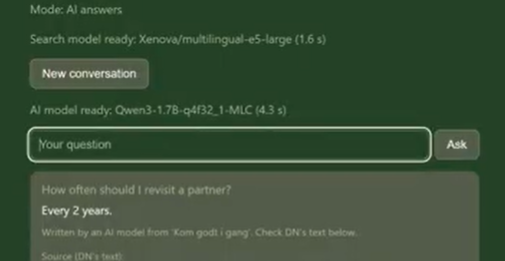

# Sommerfugleagenten

A password-protected web app that helps the volunteer butterfly ambassadors of Danmarks Naturfredningsforening (DN) answer questions about their working guide and look up host plants for butterflies. Everything runs in the browser: no server, no API key, and the user's questions never leave their computer.

Live: https://hokl2000.github.io/sommerfugleagenten/ (password required – the content is shared with DN's ambassadors only)

## What it does
- **Ask the guide** – questions in English are answered by a small AI model that has read DN's guide. DN's own Danish text is shown under every answer as the source.
- **Butterflies & plants** – which host plants and nectar plants support which butterflies (92 plant–butterfly pairs, 11 nectar plants).

## How it works
1. **Encrypted data** – all content is encrypted (AES-GCM, key derived from the password with PBKDF2) and decrypted locally with the Web Crypto API.
2. **Precomputed search index** – the guide is translated to English line by line and embedded once, offline, with multilingual-e5-large (Node.js + Transformers.js). The browser only embeds the question.
3. **Search gate in code** – if the question is not close enough to anything in the guide, the page answers "That is not in the guide." and the AI model is never called.
4. **AI answer** – Qwen3-1.7B runs in the browser via WebLLM and WebGPU, with the whole guide in its prompt. The conversation is kept byte-identical between questions, so the model's KV cache is reused: the first answer takes about 2 minutes on a laptop with integrated graphics, follow-up answers a few seconds.
5. **Answer checks in code** – every answer is compared with the guide, sentence by sentence. Answers that are not supported by the guide are replaced with "That is not in the guide." Answers are only shown after the checks.
6. **Fallback** – without WebGPU, or on slow hardware, the page answers with search only and shows DN's own text.

## What I learned
- **Guardrails belong in code, not in the prompt.** The 1.7B model copied its own refusals into later answers and invented plants that are not in the guide. Moving the refusal into a search gate and checking each sentence fixed both.
- **Measure before fixing.** Slow answers, a cache that was not reused and a known WebLLM bug (versions 0.2.83+, issue #844) were all found by logging and measuring, not by guessing.
- **A small open model is a demonstration.** With a larger hosted model, the same design would answer faster and handle more ways of phrasing a question.

## Limitations
- The first visit downloads about 1.5 GB of model files; the browser caches them afterwards.
- The AI answers need a GPU with WebGPU support. Older integrated graphics fall back to search only.
- The thresholds for the gate and the checks are calibrated on a small set of test questions.

## Privacy
No questions, answers or passwords are sent or stored. The browser caches the model files only.

## Credits and licences
- Search: multilingual-e5-large (MIT) via Transformers.js (Apache 2.0) and ONNX Runtime (MIT)
- Answers: Qwen3-1.7B (Apache 2.0) via WebLLM (Apache 2.0)
- Content: DN's working papers "Kom godt i gang som sommerfugleambassadør" and a plant catalogue, used with DN's permission behind the login. The content is not in this repository in readable form.

© 2026 Holger Klint. All rights reserved.
